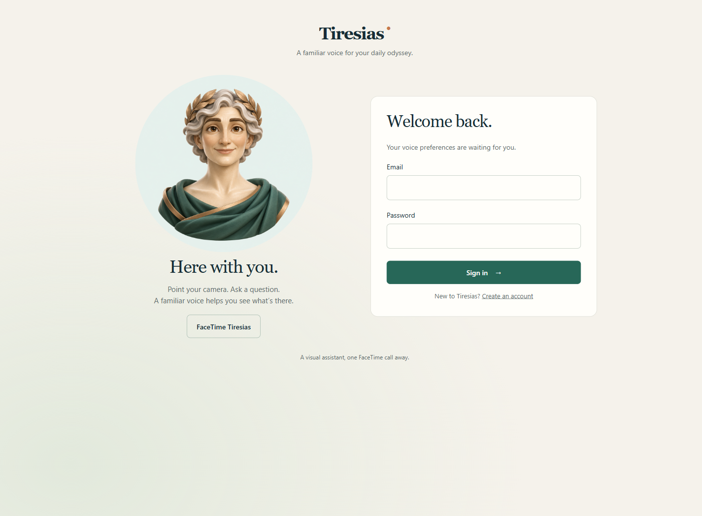
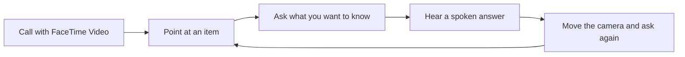
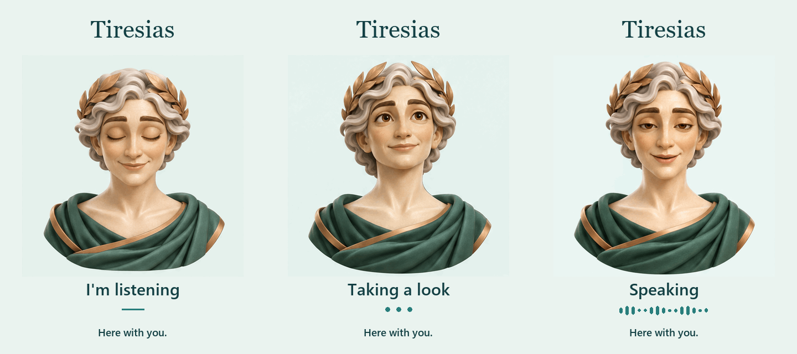
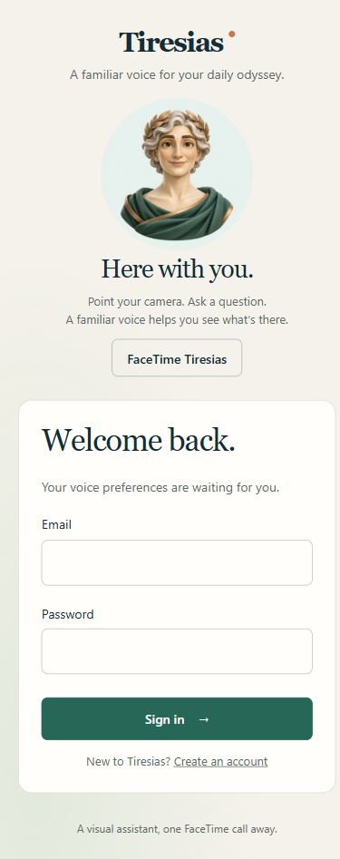
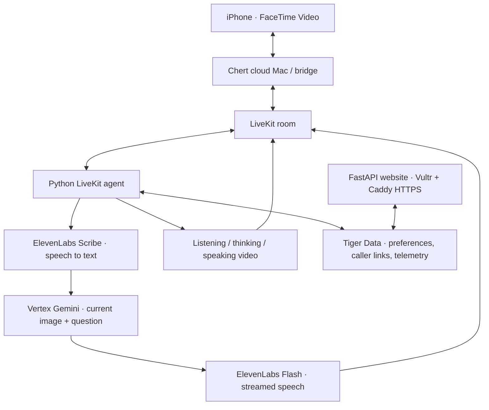

<div align="center">


# Tiresias

### A familiar voice for your daily odyssey.

**Point your phone. Ask a question. Hear what's there.**

Read an everyday label or ask about what your camera sees,<br>
through a real FaceTime Video call, in a voice you choose.

<br>

**[↗ Open tiresias.ink](https://tiresias.ink)** &nbsp; · &nbsp; **[Devpost](https://devpost.com/software/tiresias-4dmnp9)** &nbsp; · &nbsp; **[Try a call](#try-a-call)**

<kbd>FaceTime + Chert</kbd> <kbd>Gemini</kbd> <kbd>ElevenLabs</kbd> <kbd>Tiger Data</kbd> <kbd>Vultr</kbd>

<br><br>



<sub>The public website at tiresias.ink. Call by FaceTime; use the website to save your voice.</sub>

</div>

<br>

## ✦ One call, a little more clarity

In *The Odyssey*, Tiresias helps Odysseus understand the path ahead. We borrowed the name for a practical question: can a familiar phone call make everyday visual information easier to reach?

Tiresias is a HackUTA '26 prototype built with blind and low-vision people in mind. We have not yet evaluated it in a study with that community. Today it reads labels and answers visual questions aloud.



> “What does this label say?” → “How many cans can you see?” → “Check this again.”

## What you can try

| | What it does |
| --- | --- |
| 📱 **A real FaceTime call** | Chert carries the phone's camera and microphone into a LiveKit voice agent. No separate camera app is required for the call. |
| 👁️ **Questions about the current view** | Gemini reads labels and answers visual questions using current images and recent conversation. |
| 🎙️ **A voice that feels familiar** | ElevenLabs realtime transcription and streamed replies, with six verified voices and saved tone/speed settings. |
| 🔗 **Remember me next time** | Link a caller once with four digits heard during a call; later calls can automatically load saved voice preferences. |
| 🏛️ **An expressive oracle** | Original Higgsfield artwork shows listening, thinking and speaking states in the call and website. |
| 📊 **Real processing records** | Hosted Tiger Data stores preferences, caller bindings and call-stage telemetry shown by the performance page. |

Say “Stop,” “Wait,” or “Repeat” to control the conversation. Calls start in English; “Speak Russian” and “Speak English” explicitly change the reply language for that call. Common noise transcripts and incomplete fragments are filtered, and unsolicited “Got it” acknowledgments have been removed. The updated behavior has regression and real-model verification; final handset checks remain necessary.

<div align="center">
<br>

<p><sub>Generated character assets used by the application. These are state animations, not lip synchronization.</sub></p>
</div>

## For judges

**Live website:** [tiresias.ink](https://tiresias.ink). Open it on desktop or mobile to register/sign in, save a voice and try a real audio preview. The main visual interaction is a FaceTime Video call; follow the [walkthrough below](#try-a-call).

**Verified deployment:** The HTTPS website, LiveKit worker and Chert connector run on Vultr under persistent systemd services. The operator’s laptop can be off. Opening the website alone does not start a FaceTime call. Deployment and service operations are described in [Persistent cloud calling](deploy/CALL-HOSTING.md).

**Recorded evidence:** 236 passing tests, real provider media tests, and owner-confirmed handset label reading and caller-linked settings. See [verification and limits](#verification-and-limits) for scope.

<details>
<summary><b>See the real mobile website</b></summary>
<br>
<div align="center">

</div>
</details>

## Try a call

1. Open [tiresias.ink](https://tiresias.ink), create an account and choose a voice. Save it and try its audio preview.
2. Place a **FaceTime Video** call to the event demo line, **+1 702 510 9706**. The operator's Chert session and worker must be active. This is a provisioned event trial line, not a promise of permanent public availability.
3. Point the rear camera at a well-lit label and ask, **“What does this label say?”** Let the answer finish. Show two items and ask how many are visible, then move to a new label and say **“Check this again.”**
4. Try **“Repeat,” “Stop,” “Speak Russian,”** or **“Speak English.”** To remember your voice for later calls, use “Remember me next time” on the website: start setup, call, and enter the four digits you hear on the signed-in site.

For a 90-second demonstration, show one label question, one follow-up, one conversation control and the saved voice on the website. Keep real question-and-answer audio audible. Call-stage metrics on the performance page measure application processing, not total phone latency.

## Architecture



| Layer | Implementation |
| --- | --- |
| Call transport | Chert FaceTime API + cloud Mac bridge; own LiveKit Cloud project |
| Agent | Python 3.12+ · LiveKit Agents 1.8 |
| Vision | `gemini-3.5-flash-lite` via Google Gen AI SDK, Vertex AI and ADC |
| Speech | ElevenLabs `scribe_v2_realtime` + `eleven_flash_v2_5` |
| Website | FastAPI · Jinja templates · HTML/CSS/JavaScript |
| Data | Hosted Tiger Data · PostgreSQL · TimescaleDB |
| Hosting | Vultr VM · persistent website, media worker and Chert connector · Caddy HTTPS |
| Artwork | Higgsfield-generated still and state GIFs, rendered locally during calls |

Camera frames arrive continuously; visual requests sample current images. This is not a Gemini Live video session. Caller links store keyed fingerprints and masked displays, and select voice preferences only; they do not grant account access.

## Quick start

Requirements: Python 3.12+, supported Node.js 22 LTS (22.12+) with npm for Chert, a provisioned Chert FaceTime line, LiveKit Cloud credentials, ElevenLabs access, a Google Cloud project with working Vertex AI access, and PostgreSQL with TimescaleDB for the website and saved preferences. Provider calls use your configured accounts.

From the repository root in PowerShell:

```powershell
python -m venv .venv
.\.venv\Scripts\python.exe -m pip install -e ".[media]"
Copy-Item .env.example .env.local
```

Edit `.env.local` and keep it private:

| Purpose | Settings |
| --- | --- |
| LiveKit | `LIVEKIT_URL`, `LIVEKIT_API_KEY`, `LIVEKIT_API_SECRET`, `AGENT_NAME=tiresias-agent` |
| Speech | `ELEVENLABS_API_KEY`, optional `ELEVENLABS_VOICE_ID` |
| Vertex vision | `GOOGLE_GENAI_USE_VERTEXAI=true`, `GOOGLE_CLOUD_PROJECT`, `GOOGLE_CLOUD_LOCATION=global`, `GEMINI_MODEL=gemini-3.5-flash-lite` |
| Website/data | `DATABASE_URL`, `APP_BASE_URL`, `ALLOW_REGISTRATION=true` for an open demo |
| Caller linking | `CHERT_PROJECT_ID`, authenticated Chert CLI credentials, and the same random `CALLER_LINK_SECRET` on website and worker |

Use `gcloud auth application-default login` to establish ADC on the worker host, or set `GOOGLE_APPLICATION_CREDENTIALS` to an authorized credentials file. AI Studio is an alternative backend, not the backend used for the verified demo. Set `ENABLE_REWARDS=false`; payments are outside this submission.

<details>
<summary><b>Terminal 1 · Website and application database</b></summary>

Apply migrations to your own application database, then start the website:

```powershell
.\.venv\Scripts\python.exe -m tiresias.migrate
.\.venv\Scripts\python.exe -m tiresias.app
```

Open `http://localhost:8000`.

</details>

<details>
<summary><b>Terminal 2 · LiveKit voice agent</b></summary>

```powershell
.\.venv\Scripts\python.exe scripts/check_livekit_env.py
.\.venv\Scripts\python.exe -m tiresias.agent.main start
```

Wait for worker registration with `agent_name` set to `tiresias-agent`.

</details>

<details>
<summary><b>Terminal 3 · Chert FaceTime bridge</b></summary>

```powershell
npx --yes --prefer-online @trychert/facetime@0.1.0-beta.21 login --device --json
npx --yes --prefer-online @trychert/facetime@0.1.0-beta.21 doctor --json
npx --yes --prefer-online @trychert/facetime@0.1.0-beta.21 dev --agent tiresias-agent --json
```

Wait for readiness, then FaceTime Video the number provisioned to your Chert account. Keep the worker and CLI running for the call. The event trial line is listed in [Try a call](#try-a-call).

</details>

## Verification and limits

The recorded full-suite baseline is **236 passing tests**. Real isolated LiveKit tests exercised ElevenLabs STT, Vertex vision, returned TTS, animated video, repeated label reads and interruption. One delayed-ready test stayed silent before bridge readiness and began audio **0.623 seconds after readiness**. That excludes total FaceTime call setup and handset latency.

Real Vertex checks verified that an incidental foreign-language question still receives an English answer, an explicit Russian request switches replies to Russian, and an explicit English request switches back. Regression tests cover common noise, incomplete fragments and conversation controls. The owner separately used a real FaceTime handset and confirmed label recognition and caller-linked preferences. The final cloud worker passed a real provider call test with two visual answers, early-stop feedback and changing avatar video. The connector is authenticated and agent-warm with no laptop call processes running. The latest changes still need the final handset recording.

Tiresias can misread labels and depends on camera framing, lighting, network and provider availability. This build has no hazard navigation, emergency assistance, real human-helper handoff, payments, Solana integration or Grok Bot automation. No recognition accuracy or total phone-response latency benchmark is claimed.

For development tests, install `pytest` and `pytest-asyncio`, configure an isolated `TEST_DATABASE_URL`, then run `python -m pytest -q`. Do not point tests at the application database. Provider smoke tools in `scripts/` make real requests and are separate from ordinary unit tests. Never commit `.env.local`, ADC files, Chert credentials, private images or runtime logs.

## Deployment

[Web deployment](deploy/README.md) covers the verified Vultr HTTPS website, service operations and rollback. [Persistent cloud calling](deploy/CALL-HOSTING.md) covers the separate LiveKit worker and Chert connector, their restricted service account and the real-call check required for a completed handoff.

<div align="center">
<br>
<sub>Built for HackUTA '26 · A familiar voice for your daily odyssey.</sub>
</div>
